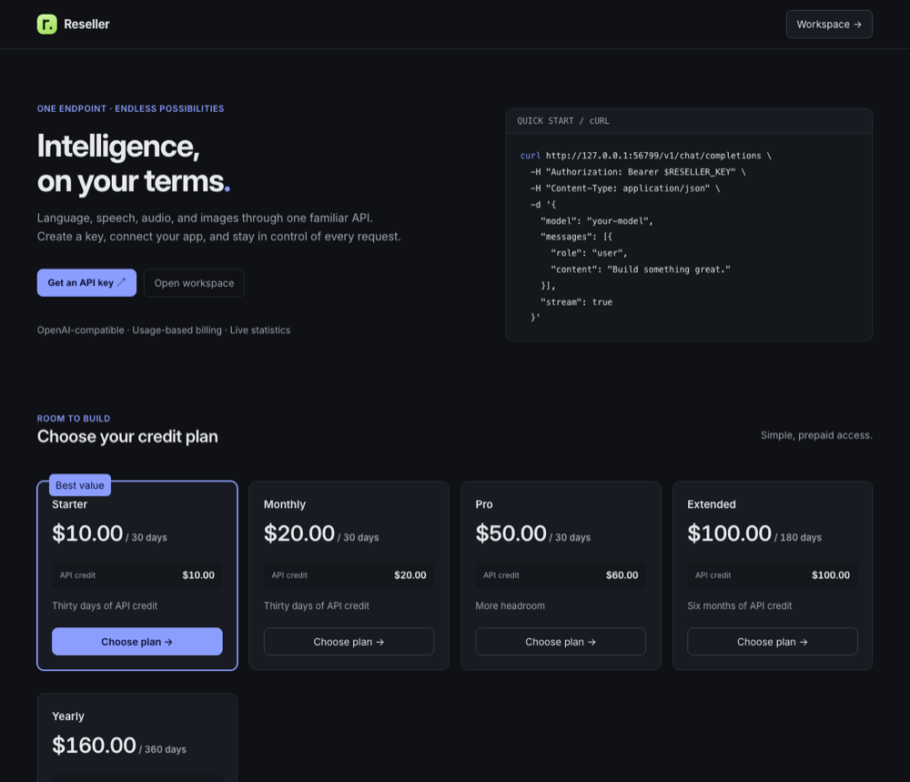

<p align="center">
  
</p>

# reseller

**Your API. Your pricing. One binary.**

reseller is a self-hosted, OpenAI-compatible API reseller written in Rust. Point it at your upstream model providers, then sell access as prepaid credit. It proxies language, speech, transcription, and image requests, issues customer keys, meters every request, and serves a white-label web workspace from the same binary.

## Features

- **Proxy:** streaming JSON, SSE, audio, multipart uploads, and WebSocket (realtime) transport.
- **Upstreams:** separate LLM, TTS, STT, and image upstreams with per-upstream timeouts, headers, model policies, and fallback chains.
- **MCP for AI agents:** a remote `POST /mcp` endpoint with OAuth 2.1 sign-in (add the URL in Claude, ChatGPT, Cursor, or VS Code) and a local `reseller mcp` stdio bridge. Agents can generate content and manage their account. See [docs/mcp.md](docs/mcp.md).
- **Signup and abuse control:** proof-of-work signup (ALTCHA-compatible), per-IP and per-account limits, rotation limits, and an auth-failure lockout.
- **Accounts and keys:** self-service accounts, shared balances, key rotation, model allowlists, and per-key usage limits.
- **Accurate metering:** integer micro-USD accounting with cached-input, per-character, per-image, per-second, and flat per-request prices. Expiring credit lots, markup overrides, and debt tracking are included.
- **Payments:** prepaid plans, single-use redeem codes, Stripe Checkout, and Payroof crypto payments (stablecoins and native coins on EVM chains) with verified, idempotent webhooks.
- **White-label branding:** name, copy, logo, favicon, colours, custom CSS, and an optional theme directory.
- **Dashboards:** responsive customer and administrator consoles with linked accounts, keys, and requests, lifetime and 30-day spend rankings, usage charts, a public developer docs page at `/docs/`, and a live statistics API.
- **Storage and packaging:** SQLite in WAL mode. No external database or frontend build is required. The Docker image is non-root and built for AMD64 and ARM64.

## Contents

- [Screenshot](#screenshot)
- [Quick start](#quick-start)
- [Configuration](#configuration)
- [Pricing and metering](#pricing-and-metering)
- [Security model](#security-model)
- [Customer API](#customer-api)
- [Proxying](#proxying)
- [MCP](#mcp)
- [Admin API](#admin-api)
- [CLI reference](#cli-reference)
- [Branding and themes](#branding-and-themes)
- [Payments](#payments)
- [Operations](#operations)
- [Development](#development)
- [License](#license)

## Screenshot

Landing page with the quick-start snippet, self-service API key with proof-of-work signup, and the prepaid plan catalogue:



## Quick start

Building from source requires **Rust 1.98 or newer**. The default database is `.reseller/reseller.db` relative to the working directory.

### Option 1: Cargo

1. Install the binary from this checkout. Once the first release is on crates.io, you can use `cargo install reseller --locked` instead.

   ```sh
   cargo install --path . --locked
   ```

2. Write a starter configuration file.

   ```sh
   reseller init
   ```

3. Edit `reseller.toml` and set `[llm].api_key`, plus your upstream URL and model.
4. Start the server.

   ```sh
   reseller
   ```

5. Save the administrator token printed on first start (see [Admin token](#admin-token)).

To skip the file, bootstrap from environment variables on the first start only (see [Environment bootstrap](#environment-bootstrap)):

```sh
OPENAI_BASE_URL=https://openrouter.ai/api/v1 \
OPENAI_API_KEY=sk-or-v1-... \
OPENAI_MODEL=your-model \
reseller
```

### Option 2: Docker

1. Start the container from a published image.

   ```sh
   docker run -d --name reseller --restart unless-stopped \
     -p 56787:56787 \
     -e OPENAI_BASE_URL=https://openrouter.ai/api/v1 \
     -e OPENAI_API_KEY=sk-or-v1-... \
     -e OPENAI_MODEL=your-model \
     -e PUBLIC_URL=https://api.example.com \
     -v reseller-data:/data \
     ghcr.io/reseller-rs/reseller:latest
   ```

2. Read the first-start administrator token from the logs.

   ```sh
   docker logs reseller
   ```

To build locally instead, run `docker build -t reseller:local .`.

### Option 3: Docker Compose

1. Set the variables you need in your shell or in a Compose `.env` file. Supported names include `OPENAI_*`, `TTS_*`, `STT_*`, `IMG_*`, `ADMIN_TOKEN`, `PUBLIC_URL`, `BRAND_NAME`, `STRIPE_*`, and `PAYROOF_*`.
2. Start the bundled stack.

   ```sh
   docker compose up -d
   ```

Pin a release tag instead of `latest` to keep deployments reproducible.

### Container details

| Item | Value |
|---|---|
| Binary | Static musl build with size-first release settings |
| Base image | `scratch`, with the binary, the CA bundle, and an empty writable `/data` |
| Shell and tools | None (no shell, `curl`, or package manager) |
| User | UID/GID `10001` |
| Database | `/data/reseller.db` |
| Healthcheck | `reseller healthcheck`, which probes the local `/readyz` over TCP |
| Shutdown grace period | `330s` in `compose.yaml` (allow up to the upstream timeout) |

Bind-mounted directories must be writable by UID `10001`.

### Local URLs

The defaults assume `localhost` and port `56787`.

| Page or endpoint | URL |
|---|---|
| Landing and create account | `http://localhost:56787/` |
| Developer docs | `http://localhost:56787/docs/` |
| Customer workspace | `http://localhost:56787/workspace/` |
| Administrator console | `http://localhost:56787/admin/` |
| OpenAI-compatible base URL | `http://localhost:56787/v1` |
| MCP endpoint | `http://localhost:56787/mcp` |
| Liveness and readiness | `/healthz` and `/readyz` |

### Admin token

If no `ADMIN_TOKEN` is supplied, the first start generates one and prints it. Save it. You need it to sign in to the administrator console.

- Run `reseller token` to print a random administrator token.
- Run `reseller reset-admin` to replace the stored token. Stop the server first.
- The token also works as an operator credential: `curl https://HOST/v1/models -H "Authorization: Bearer $ADMIN_TOKEN"` and the same on `/v1/*` and `/mcp` generation tools. It is accepted even when `require_key` is on, sees the full model catalog, is never billed, has no limits, and its requests are logged without an account. On `/v1/keys`, `/v1/account`, and the account tools it is answered with `403 admin_token_not_customer` (use `/admin/api`), which does not count as an authentication failure.

## Configuration

`reseller init` writes a starter file (default `reseller.toml`, mode `0600`). It never overwrites an existing file. The file is generated from [`reseller.example.toml`](reseller.example.toml), which is the **full annotated reference** for every setting and default. Unknown keys are rejected.

### How settings are stored

- On **first start only**, the TOML file and the bootstrap environment variables seed SQLite. The file is not read again once the database holds settings.
- Afterwards, **Admin > Settings** is authoritative. To manage settings as a file, use `reseller config export` and `reseller config import` with the server stopped.
- Environment and file edits do not override an existing database.
- CORS changes take effect after a restart. Other settings apply to new requests.
- Secrets are redacted in API responses. A blank secret field keeps the current value.
- Changing `key_pepper` invalidates all customer credentials, unredeemed codes, and outstanding signup challenges.

### Sections at a glance

Defaults appear in parentheses.

| Section | Purpose |
|---|---|
| Top level | `public_url` (`http://localhost:56787`), `admin_token`, `key_pepper` (both at least 24 characters, generated if unset), `model_policy` and `voice_policy` (`default`, `force`, or `passthrough`; default `default`), `markup_pct` (`30`), `require_key` (`true`), `accept_any_token` (`false`), `trust_proxy` (`false`), `cors_origin` (empty), `max_json_body_bytes` (50 MiB), `max_stream_body_bytes` (512 MiB), `upstream_timeout_seconds` (300), `log_retention_days` (30), `max_log_entries` (5000) |
| `[branding]` | White-label name, copy, logos, colours, and CSS (see [Branding and themes](#branding-and-themes)) |
| `[llm]`, `[tts]`, `[stt]`, `[image]` | Upstreams: `base_url` (`https://api.openai.com/v1`), `api_key`, `model`, `fallbacks` (max 10), `timeout_seconds` (0 uses `upstream_timeout_seconds`, max 3600), and `headers` (max 20; credential and framing headers are refused). `[tts]` also has `voice`. |
| `[prices.<model>]` | Upstream prices in USD (see [Pricing and metering](#pricing-and-metering)) |
| `[signup]` | Anonymous signup: `enabled` (`true`), `free_credit_usd` (`"0.10"`), `free_credit_expiry_days` (30; 0 means never; max 3650), `ip_limit_per_month` (2; 0 turns it off), `cooldown_seconds` (30; 0 turns it off), `global_hourly_limit` (100; 0 turns it off), `pow_max_number` (100000; 0 disables proof of work; max 10000000), `pow_ttl_seconds` (300; 10 to 86400), and `[signup.ip_overrides]` (`"1.2.3.4" = N`, where 0 means unlimited) |
| `[keys]` | `max_per_account` (10 active keys; must be above 0), `max_new_per_day` (20 created or rotated per account in a rolling 24 hours; 0 turns it off), `rotate_cooldown_seconds` (300; 0 turns it off; max 86400), and `[keys.default_limits]` (`rpm`, `requests`, `tokens`, `spend`, `max_children`, `allowed_models`, copied onto each new account's first key; child keys inherit their parent's limits) |
| `[rate_limits]` | `management_per_minute` (120), `auth_failures_per_hour` (20), `max_concurrent_requests` (8), `checkouts_per_hour` (10), `redeem_failures_per_hour` (10), `challenges_per_minute` (10). 0 disables each one. |
| `[mcp]` | `enabled` (`true`), `oauth` (`true`; OAuth sign-in for `/mcp`, see [MCP](#mcp)), and `max_media_bytes` (16 MiB; 1 byte to 256 MiB), the largest audio or image returned inline |
| `[stripe]` | `secret_key`, `webhook_secret` |
| `[[models]]` | Public model catalog: `id`, `upstream`, `aliases`, `enabled`, `name`, `description`, `owned_by`, `created`, `context_length`, `input_modalities`, `output_modalities`, `show_pricing` |
| `[payroof]` | Crypto payments: `deposits` (`true`), `deposit_eta_minutes` (`5`), `project`, `token`, `webhook_secret`, `stablecoins`, `native_coins`, `chains`, rate source, `quote_ttl_minutes`, and `underpayment_tolerance_pct` (`0.5`) |

### Value formats

- Use decimal **strings** for prices, percentages, and spend-limit amounts, for example `"0.5"`.
- Management endpoints also accept numeric USD amounts for grants, plans, and codes.
- Responses expose money as decimal strings and timestamps as Unix seconds.
- Expiry inputs accept Unix seconds or RFC 3339.

```toml
markup_pct = "30"

[prices.default]
input = "0.5"
output = "1.5"

[prices."my-tts-model"]
input = "0"
output = "0"
characters = "15"        # USD per 1M input characters

[keys.default_limits]
rpm = 60
max_children = 2
requests = { max = 2000, window_hours = 24 }
tokens = { max = 1000000, window_hours = 720 }
spend = { max_usd = "5", window_hours = 720 }
```

### Environment bootstrap

These variables seed the settings on **first start only**. They override the TOML file at that point. `ADMIN_TOKEN` and `KEY_PEPPER` must be at least 24 characters. Leave them unset to have secure values generated.

| Group | Variables |
|---|---|
| LLM upstream | `OPENAI_BASE_URL`, `OPENAI_API_KEY`, `OPENAI_MODEL`, `OPENAI_MODEL_FALLBACKS` |
| TTS upstream | `TTS_BASE_URL`, `TTS_API_KEY`, `TTS_MODEL`, `TTS_MODEL_FALLBACKS`, `TTS_VOICE` |
| STT upstream | `STT_BASE_URL`, `STT_API_KEY`, `STT_MODEL`, `STT_MODEL_FALLBACKS` |
| Image upstream | `IMG_BASE_URL`, `IMG_API_KEY`, `IMG_MODEL`, `IMG_MODEL_FALLBACKS` |
| Core | `ADMIN_TOKEN`, `KEY_PEPPER`, `MARKUP_PCT`, `FREE_CREDIT_USD` (sets `signup.free_credit_usd`) |
| Public site | `PUBLIC_URL`, `BRAND_NAME` |
| Stripe | `STRIPE_SECRET_KEY`, `STRIPE_WEBHOOK_SECRET` |
| Payroof | `PAYROOF_API_URL`, `PAYROOF_PROJECT`, `PAYROOF_TOKEN`, `PAYROOF_WEBHOOK_SECRET` |

Fallback lists are comma-separated.

### Runtime environment variables

These variables apply on every start.

| Variable | Default | Purpose |
|---|---|---|
| `HOST` | `0.0.0.0` | Listen address |
| `PORT` | `56787` | Listen port |
| `DB_FILE` | `.reseller/reseller.db` | SQLite database path |
| `RESELLER_CONFIG` | `reseller.toml` | Seed file (read on first start only) |
| `RESELLER_THEME_DIR` | none | White-label theme directory |
| `RUST_LOG` | `reseller=info` | Log filter |
| `RESELLER_URL`, `RESELLER_CREDENTIALS`, `RESELLER_OUTPUT_DIR`, `RESELLER_TOKEN` | see [MCP](#mcp) | Used by `reseller mcp` only |

The application does not read `.env` files. `public_url` controls dashboard links, payment redirects, and the MCP Origin check, so set it to the externally reachable origin. Price-table model names match case-insensitively, and `default` is the fallback entry.

## Pricing and metering

Upstream cost is computed once from the exact decimal sum. It is rounded half-up to whole micro-USD. A positive cost never rounds to zero, so tiny requests cannot be repeated for free.

```text
usage_cost = provider usage.cost                 if the upstream reported one (even 0)
           = ((input - cached_input) * input_price
              + cached_input * cached_input_price     (defaults to input_price when unset)
              + output * output_price
              + characters * characters_price) / 1,000,000
             + audio_seconds * audio_second_price
             + images * image_price               otherwise
upstream   = usage_cost + request_price           request_price only for successful (2xx) requests
billed     = round(upstream * (1 + markup_pct / 100))
```

### Price fields

Each `[prices.<model>]` table takes these fields. All values are decimal strings in USD.

| Field | Unit | Default |
|---|---|---|
| `input` | Per 1M input tokens | `0.5` |
| `output` | Per 1M output tokens | `1.5` |
| `cached_input` | Per 1M cached input tokens | `input` price |
| `characters` | Per 1M TTS input characters | `0` |
| `audio_second` | Per second of audio | `0` |
| `image` | Per generated image | `0` |
| `request` | Flat fee per successful request | `0` |

Cached tokens are the tokens the provider reports in `prompt_tokens_details.cached_tokens`, or the equivalent Responses and realtime fields. Reasoning tokens are already part of the provider's output count.

### Billing rules

1. A provider-reported `usage.cost` (USD) replaces the token, audio, image, and character components. This includes an explicit zero. The flat `request` fee is still added for successful requests.
2. Markup resolves in this order: key, then account, then global `markup_pct`.
3. Credit is consumed soonest-expiring first. Non-expiring lots come last.
4. Usage, debit, request metadata, and counters commit in one transaction.
5. For `/v1/chat/completions`, `/v1/responses`, and `/v1/completions`, tokens are **estimated** when the upstream reports no usage at all. The estimate uses about four characters per token, based on the request text and the generated text. The request row is flagged `estimated: 1`. MCP generation results report this as `usage_estimated`.
6. For other routes, if a provider returns no usage and no supported audio duration, only the flat `request` fee applies. Use providers that report usage.

Every request row records the full breakdown behind its charge: `tokens`, `input_tokens`, `cached_tokens`, `output_tokens`, `characters`, `audio_ms`, `images`, `upstream_usd`, `billed_usd`, and `estimated`. Customers audit each line with everything except `upstream_usd`: customer request and usage views never show the provider cost. Administrators see all fields.

Each key also keeps its lifetime billed spend (`billed_usd`), which outlives request log and usage retention. An account's lifetime spend is the sum over its keys.

### Limits and debt

- Balance and spend or token checks are **soft preflight limits**. Concurrent in-flight requests can overshoot. The per-account `max_concurrent_requests` limit bounds this.
- Uncovered spend becomes account debt. Future top-ups settle that debt before they become spendable credit.
- Request admission and RPM checks are serialized in SQLite. Hourly usage windows include the entire boundary hour.
- A completed admitted request counts, even if the upstream failed.
- Model usage is aggregated for up to 367 days. Detailed request retention is bounded separately by `log_retention_days` and `max_log_entries`.

### Stream and WebSocket inspection

- SSE inspection works across chunk boundaries with bounded memory.
- JSON bodies up to 4 MiB are parsed whole. Larger bodies (for example base64 images) keep only their last 256 KiB. The trailing `usage` object is read from that tail, and inline images are counted as they stream.
- WAV and 16-bit PCM durations can be estimated. The rate and channels come from the content type, with a default of 24 kHz mono.
- WebSocket sessions are authenticated, admitted, and logged like other requests. Usage from each realtime `response.done` event is summed and billed when the session ends.
- Balance is checked at admission only, so a long session can run into debt. Sessions are bounded by `upstream_timeout_seconds`.
- Upstream costs for failed fallback attempts cannot be recovered unless the provider reports them in the final response.

## Security model

### Credentials

Every key has two secrets. Each is shown only once.

| Secret | Format | Access |
|---|---|---|
| API key | `sk-res-<64 hex>` | Full access: proxy and account management |
| Dashboard token | `dash_<64 hex>` | Account management only. It **cannot call the proxy**, which fails with `401 dashboard_token_not_allowed`. |

Both secrets are stored only as HMAC-SHA256 digests keyed with `key_pepper`. Redeem codes are hashed the same way.

Send credentials as `Authorization: Bearer ...` or `x-api-key`. Tokens in query strings are not supported. The administrator token goes in `x-admin-token` or the bearer header, and it is compared in constant time. Blocked or expired API keys keep read-only workspace access (and their dashboard tokens too): they cannot create, rotate, or edit keys (`403 key_inactive`). Revoked credentials get no access.

### Signup with proof of work

Anonymous signup uses `GET /v1/signup/challenge`, then `POST /v1/signup`. The challenge is an ALTCHA v1 (SHA-256) puzzle:

```json
{"algorithm":"SHA-256","challenge":"<hex>","maxnumber":100000,
 "salt":"<hex>?expires=<unix>","signature":"<hex>"}
```

To solve it, the client finds the integer `number` in `0..=maxnumber`, where `hex(sha256(salt + decimal(number)))` equals `challenge`. It then submits `base64(JSON{algorithm, challenge, number, salt, signature})` as `altcha`.

- `signature` is an HMAC-SHA256 under a key derived from `key_pepper`, so the server keeps no challenge state.
- Each solution is single use. It is recorded in `pow_spent` and purged after expiry.
- A solution expires after `pow_ttl_seconds`.
- A solution is consumed only when the account is actually created. A rate-limited attempt does not burn it.
- With `signup.pow_max_number = 0`, the challenge endpoint returns `{"required":false}`, and `altcha` may be omitted.
- The bundled web UI and the `reseller mcp` bridge solve the puzzle for you.

```sh
# Solve with any ALTCHA v1 client. The commands show the HTTP shape only.
curl http://localhost:56787/v1/signup/challenge
curl http://localhost:56787/v1/signup \
  -H 'Content-Type: application/json' \
  -d '{"name":"my-app","contact":"me@example.com","altcha":"<base64 solution>"}'
```

Signup errors:

| Status | Code | Cause |
|---|---|---|
| 400 | `pow_required` | No solution sent |
| 400 | `pow_invalid` | Malformed, bad signature, expired, number out of range, or wrong solution |
| 409 | `pow_replayed` | Solution already used |
| 403 | `signup_disabled` | Signup is turned off |
| 429 | see [Rate limits](#rate-limits) | Guard limits |

### Rate limits

Every `429` response carries a `Retry-After` header in seconds. The header is 60 when the server has no better estimate.

| Limit | Scope | Config | 429 `code` |
|---|---|---|---|
| Management requests (`/v1/signup`, `/v1/keys`, `/v1/account`, `/v1/plans`, `/mcp`, `/oauth/*`, `/admin/api/*`) | Client IP, per minute | `rate_limits.management_per_minute` | `management_rate_limited` |
| Signup challenges | Client IP, per minute | `rate_limits.challenges_per_minute` | `challenge_rate_limited` |
| Invalid credentials | Client IP, per hour | `rate_limits.auth_failures_per_hour` | `too_many_auth_failures` |
| Invalid redeem codes | Account, per hour | `rate_limits.redeem_failures_per_hour` | `redeem_rate_limited` |
| Checkout attempts | Account, per hour | `rate_limits.checkouts_per_hour` | `checkout_rate_limited` |
| In-flight proxy requests | Account | `rate_limits.max_concurrent_requests` | `concurrency_limit_exceeded` |
| Self-service key creations per calendar month | IP | `signup.ip_limit_per_month`, `signup.ip_overrides` | `ip_key_limit` |
| Gap between creations | IP | `signup.cooldown_seconds` | `creation_cooldown` |
| Key creations (signup, child keys, rotations) per hour | Global | `signup.global_hourly_limit` | `creation_rate_limited` |
| Active keys | Account | `keys.max_per_account` | `account_key_limit` |
| Keys created or rotated per rolling 24 hours | Account (customers, admin exempt) | `keys.max_new_per_day` | `key_creation_daily_limit` |
| Minimum key age before rotation | Key (customers, admin exempt) | `keys.rotate_cooldown_seconds` | `rotate_cooldown` |
| Active child keys of one API key | Key | `keys.default_limits.max_children`, or the per-key limit | `child_key_limit` |
| Requests per minute | Key | `rpm` | `rate_limit_exceeded` |
| Requests per window | Key | `requests` | `request_limit_exceeded` |
| Tokens per window | Key | `tokens` | `token_limit_exceeded` |
| Spend per window | Key | `spend` | `spend_limit_exceeded` |

Accounts that are subscribed or have `can_create_keys` set bypass the per-IP monthly allowance and the cooldown. They do not bypass the global, daily, or account key caps. The in-memory limiter state is per process and is not persisted, so a restart only relaxes limits.

### Auth-failure lockout

Each invalid API key, dashboard token, administrator token, or redeem code charges the client IP's auth-failure budget. The budget is a token bucket. It allows a burst of `auth_failures_per_hour`, then one more attempt every `3600 / limit` seconds.

When the budget is exhausted, **every request from that IP that carries a credential** gets `429 too_many_auth_failures`. This applies to `/v1/*`, `/mcp`, and `/admin/api/*`. The check runs before any database lookup, for at most one hour. Revoked or blocked keys and other non-guessing errors do not count.

### Origin and response headers

- `POST /mcp` refuses requests whose `Origin` header does not match `public_url`, `cors_origin`, or any origin when `cors_origin = "*"`. The response is `403 origin_not_allowed`. Requests without an `Origin` header (CLI and desktop agents) are accepted. This blocks DNS-rebinding attacks through a browser.
- Every response carries `Cache-Control: no-store`, `X-Content-Type-Options: nosniff`, `Referrer-Policy: no-referrer`, and a strict `Content-Security-Policy` with `frame-ancestors 'none'`.
- `Strict-Transport-Security` is added when `public_url` starts with `https://`.
- `/.well-known/*`, `/oauth/token`, `/oauth/register`, and `/oauth/revoke` answer CORS for any origin (`Access-Control-Allow-Origin: *`, no credentials) whatever `cors_origin` is. The consent API (`/oauth/api/authorize`) accepts same-origin requests only. OAuth codes and tokens are stored as HMAC digests, and registration is limited to 30 clients per IP per hour.
- When `cors_origin` is set (`*` or one exact origin), `WWW-Authenticate` is exposed on `/mcp`, and CORS allows the `Authorization`, `Content-Type`, `x-api-key`, `x-admin-token`, `mcp-protocol-version`, `mcp-method`, and `mcp-name` headers.
- The customer UI uses session storage, removes login tokens from URL fragments, and never embeds credentials in page HTML.
- Logs contain request metadata only. They never contain prompts, bodies, audio, auth headers, or query strings.

### Behind a proxy

Place a TLS reverse proxy in front of public deployments.

- `trust_proxy` defaults to off. The TCP peer address is then the client IP.
- Enable it **only** when direct access to the application is blocked and your edge overwrites incoming forwarding headers. It trusts `CF-Connecting-IP`, then the **last** `X-Forwarded-For` address. Earlier entries are controlled by the client.
- If `trust_proxy` is enabled wrongly, clients can spoof their IP and evade every per-IP limit.
- If it is disabled behind a proxy, all users share one IP. The per-IP limits (signup allowance, cooldown, and lockout) then apply to everyone at once.

### Database secrets

Settings contain upstream and payment secrets that must be recoverable to proxy requests. Protect the database and its backups as credentials.

## Customer API

Customer routes use `Authorization: Bearer <api key or dashboard token>` unless marked public. Errors use the OpenAI shape `{"error":{"message","type","param","code"}}`. List endpoints default to 50 items and cap at 200.

| Method | Path | Auth | Purpose |
|---|---|---|---|
| `GET` | `/v1/plans` | Public | Active plans and `payment_methods` |
| `GET` | `/v1/signup/challenge` | Public | Proof-of-work challenge |
| `POST` | `/v1/signup` | Public | Body `{"name"?, "contact"?, "altcha"}`. Creates an account and its first key. |
| `POST` | `/v1/keys` | Key or token (not anonymous) | Body `{"name", "limits"?}`. Creates a child key on the caller's account. The child inherits the caller's limits. Limits you send replace single fields and must be no looser than the parent's (a lower or equal count, a window at least as long, a subset of its model allowlist), otherwise `400 limits_exceed_parent`. Blocked or expired callers get `403 key_inactive`. Returns `401` when anonymous. |
| `GET` | `/v1/keys?q=&status=&sort=&dir=` | Any | List the caller's keys with `billed_usd` (lifetime spend) and `usage_30d_usd`. `sort` is `created`, `name`, `status`, `last_used`, `spend`, or `usage`. |
| `GET` | `/v1/keys/:id` | Any | One of the caller's keys with its 30-day usage series |
| `PATCH` | `/v1/keys/:id` | Any | Rename or block (`{"name"?, "status":"blocked"}`). Customers cannot reactivate a key. |
| `POST` | `/v1/keys/:id/rotate` | Any | Replace the key and keep its limits, pricing, expiry, usage windows (so rotating does not reset limits), and connected OAuth apps. The old key is blocked. |
| `GET` | `/v1/models` | Key | Model catalog, local and not metered |
| `GET` | `/v1/models/:id` | Key | One catalog entry, or `404 model_not_found` |
| `GET` | `/v1/account/models` | Any | The `/v1/models` list for the caller's key, also with a dashboard token |
| `GET` | `/v1/account` | Any | Account, balance, lifetime `billed_usd`, credit lots, subscription, and `top_up` instructions |
| `GET` | `/v1/account/usage?days=30&key=` | Any | Daily and per-model usage (`days` 1 to 365) |
| `GET` | `/v1/account/requests?limit=20&offset=0&key=&model=&kind=&status=` | Any | Request history. Rows carry `key_name` and `key_prefix`. |
| `POST` | `/v1/account/redeem` | Any | Body `{"code":"RES-..."}` |
| `POST` | `/v1/account/checkout` | Any | Body `{"plan_code":"monthly","method":"stripe"}` or `"crypto"` |
| `GET` | `/v1/account/payments` | Any | The caller's orders (latest 50) |
| `GET` | `/v1/account/payments/:id` | Any | One order, with crypto quotes and transfers |
| `GET` | `/v1/account/apps` | Any | Connected OAuth apps: `{"apps":[{id, client_id, client_name, client_uri, logo_uri, key_id, key_prefix, key_name, scope, created_at, last_used_at}]}` |
| `DELETE` | `/v1/account/apps/:id` | Any | Revokes a connected app and its tokens. Returns `{"revoked":true,"id"}`. |
| `POST` | `/webhooks/stripe` | Stripe signature | Raw Stripe event |
| `POST` | `/webhooks/payroof` | Payroof signature | Payroof transfer event |

### Keys

```sh
# Sign up after solving the challenge. The response holds key, dashboard_token,
# dashboard_url, api_base, and limits.
curl -X POST http://localhost:56787/v1/signup -H 'Content-Type: application/json' \
  -d '{"name":"my-app","altcha":"<base64 solution>"}'

export RESELLER_KEY=sk-res-...

# Create another key on the same account
curl -X POST http://localhost:56787/v1/keys \
  -H "Authorization: Bearer $RESELLER_KEY" -H 'Content-Type: application/json' \
  -d '{"name":"ci"}'

curl http://localhost:56787/v1/keys -H "Authorization: Bearer $RESELLER_KEY"

# Rotate. Returns 429 rotate_cooldown while the key is younger than keys.rotate_cooldown_seconds.
curl -X POST http://localhost:56787/v1/keys/KEY_ID/rotate -H "Authorization: Bearer $RESELLER_KEY"
```

A new key (from signup, a child key, or a rotation) is returned once, as `{id, account_id, key, key_prefix, dashboard_token, dashboard_url, api_base, limits, notice}`. All keys on an account share its credit.

### Account, redeem, and checkout

```sh
curl http://localhost:56787/v1/account -H "Authorization: Bearer $RESELLER_KEY"
curl 'http://localhost:56787/v1/account/usage?days=7' -H "Authorization: Bearer $RESELLER_KEY"
curl 'http://localhost:56787/v1/account/requests?limit=20&status=2xx' -H "Authorization: Bearer $RESELLER_KEY"

# Returns 400 invalid_code when the code is unknown, expired, or already used
curl -X POST http://localhost:56787/v1/account/redeem \
  -H "Authorization: Bearer $RESELLER_KEY" -H 'Content-Type: application/json' \
  -d '{"code":"RES-XXXX-XXXX"}'

curl http://localhost:56787/v1/plans
# Returns {"method","url","order_id"}
curl -X POST http://localhost:56787/v1/account/checkout \
  -H "Authorization: Bearer $RESELLER_KEY" -H 'Content-Type: application/json' \
  -d '{"plan_code":"monthly","method":"stripe"}'
curl http://localhost:56787/v1/account/payments -H "Authorization: Bearer $RESELLER_KEY"
```

## Proxying

```sh
curl http://localhost:56787/v1/chat/completions \
  -H "Authorization: Bearer $RESELLER_KEY" \
  -H 'Content-Type: application/json' \
  -d '{"model":"your-model","messages":[{"role":"user","content":"Hello"}],"stream":true}'
```

### Routing

Routing replaces `/v1` with the configured base path and keeps the query string.

| Client path | Upstream |
|---|---|
| `/v1/audio/speech` | TTS |
| `/v1/audio/transcriptions`, `/v1/audio/translations` | STT |
| `/v1/images`, `/v1/images/*` (generations, edits, variations) | Image |
| All other proxied `/v1/*` routes (chat completions, completions, embeddings, moderations, responses, realtime) | LLM |

`/v1/models`, `/v1/keys`, `/v1/account`, `/v1/plans`, and `/v1/signup` are handled locally and are never proxied. Other paths return `404 unknown_url`, and a wrong method returns `405 method_not_allowed` with an `Allow` header.

### Models

`GET /v1/models` lists the catalog in the OpenAI format. It needs a key, is not metered, and returns `429 insufficient_quota` when the balance is empty. The list never shows upstream names, URLs, keys, or raw prices. Disabled entries and models the key may not use are hidden, and aliases are not listed.

```toml
[[models]]
id = "assistant"
upstream = "vendor/large-model-2026"
aliases = ["gpt-4o"]
name = "Assistant"
context_length = 128000
show_pricing = true
```

With a catalog, a client model is resolved by id or alias and rewritten to `upstream`. An unknown, disabled, or disallowed model returns `404 model_not_found`. Filled and forced models skip this step. Without a catalog, the list shows the configured route models. Pricing, when shown, uses the caller's effective markup.

### Model and voice policies

- `default`: omit `model` to use the configured `[llm].model`. A client value is kept.
- `passthrough`: forwards the client's value unchanged. A wrong model fails upstream.
- `force`: always uses the configured model.

The same policy governs the multipart `model` field on uploads. `force` replaces it, and `default` fills it only when it is missing. The audio payload still streams without buffering. WebSocket connections apply the policy to the `?model=` query parameter before admission and forwarding.

Fallbacks apply only when the final model equals the route's configured model.

### Image requests

```sh
curl http://localhost:56787/v1/images \
  -H "Authorization: Bearer $RESELLER_KEY" \
  -H 'Content-Type: application/json' \
  -d '{"model":"meta/muse-image","prompt":"Make the sky orange",
       "input_references":[{"type":"image_url","image_url":{"url":"data:image/jpeg;base64,..."}}]}'
```

JSON requests apply model and voice policies. Chat requests stream usage reporting. Multipart uploads stream with bounded size, and only the `model` form field is rewritten by the policy.

### Fallbacks

- Fallbacks apply only to JSON requests that use the configured model, and only before forwarding response headers.
- Availability errors (`400`, `402`, `404`, `408`, `429`, and `5xx`) and connection or timeout failures can trigger the next model.
- Fallback models must also be allowed by the key.
- Client-selected models are not replaced by fallbacks.
- Multipart uploads get a single forward attempt.
- Redirects are not followed.
- Hop-by-hop headers and local credentials are removed before forwarding.

### Response headers

| Header | Meaning |
|---|---|
| `X-Request-Id` | Request identifier |
| `X-Key-Prefix` | Prefix of the key used |
| `X-Account-Balance-USD` | Balance before the request (pre-request snapshot) |
| `X-Model-Fallback` | Set when a fallback model answered |

### Proxy errors

Failures use the OpenAI shape `{ "error": { "message": "...", "type": "...", "param": null, "code": "..." } }`. The `type` is `invalid_request_error` (400, 401, 404, 405, 409, 413, 415), `permission_error` (403), `insufficient_quota` (code `insufficient_quota`), `rate_limit_error` (other 429), or `server_error` (5xx). `param` is `"model"` for model errors. Upstream errors are rebuilt in this shape: a JSON error keeps only its `message`, `type`, `param`, and `code` (other fields such as upstream user ids or provider metadata are dropped), a non-JSON body gets a generic message with code `upstream_error`, and an upstream 401, 402, or 403 (a problem with the operator's upstream account, not the caller's key) becomes `502 upstream_error`.

| Status | Codes |
|---|---|
| 401 | `missing_api_key`, `invalid_api_key`, `key_revoked`, `key_blocked`, `key_expired`, `dashboard_token_not_allowed` |
| 403 | `account_suspended` |
| 404 | `model_not_found`, `unknown_url` |
| 405 | `method_not_allowed` |
| 413 | Body too large |
| 429 | `insufficient_quota` when the balance is empty, and limits (see [Rate limits](#rate-limits)) |
| 502, 504 | Upstream failure |
| 503 | `proxy_configuration_error` when the route's upstream has no API key |

## MCP

Agents can use the service through the Model Context Protocol. There are two ways to connect.

- **Remote endpoint:** a stateless Streamable HTTP endpoint at `POST /mcp`. It supports protocol `2026-07-28` (current) and the legacy `2025-11-25` handshake. An `initialize` that asks for an older revision is answered with `2025-11-25`; requests that name an older revision in `MCP-Protocol-Version` are refused. Every request needs a credential: without one the answer is `401` with a `WWW-Authenticate` header that points OAuth clients to `/.well-known/oauth-protected-resource/mcp`.
- **Local bridge:** `reseller mcp` runs next to the agent. It keeps credentials and the signup proof of work on the agent's machine.

**Connect with OAuth.** Add `https://HOST/mcp` as a remote MCP server in Claude, ChatGPT, Cursor, or VS Code. The client registers itself (RFC 7591), and a browser page on this server asks you to sign in with an API key or dashboard token (or create an account) and to allow the connection. It uses PKCE `S256`, resource indicators, one-hour access tokens (`mcp_at_...`), and rotating refresh tokens that expire after 90 days idle. Tokens are bound to your key, stop working when the key does, and are valid on `/mcp` only. Customers revoke apps in the dashboard. `[mcp].oauth = false` turns this off. **Static bearer alternative:** send an API key or dashboard token as `Authorization: Bearer ...`. The administrator token works for generation tools only.

Generation tools go through the same admission, limits, metering, and model policy as the HTTP API. Set `[mcp].enabled = false` to turn the endpoint off. It then answers `404 mcp_disabled`.

```sh
# Remote with a static key (clients without OAuth support). OAuth clients just need the URL.
claude mcp add --transport http reseller https://api.example.com/mcp \
  --header "Authorization: Bearer sk-res-..."

# Local bridge, which can sign up
claude mcp add reseller -- reseller mcp --url https://api.example.com
```

See [docs/mcp.md](docs/mcp.md) for client configuration, the tool reference, the signup walkthrough, the error codes, and security notes.

## Admin API

All routes live under `/admin/api`. They require the administrator token, sent as `x-admin-token` or as a bearer token. List endpoints default to 50 items and cap at 200. Account credit history, codes, and payments return the latest 200.

| Method | Path | Purpose |
|---|---|---|
| `GET` | `/overview` | Lifetime totals and margin. `outstanding_usd` is the unexpired credit of active accounts. Credit of suspended accounts is `suspended_credit_usd`, uncovered spend is `debt_usd`. `active_keys` counts keys that can call the API now. |
| `GET` | `/usage?days=30` | Daily and per-model series |
| `GET` | `/events` | Server-sent snapshot every five seconds |
| `GET` | `/keys?q=&status=&account=&sort=&dir=&limit=&offset=` | List keys with `billed_usd`, `usage_30d_usd`, and `account_contact`. `sort` adds `account`, `spend`, and `usage` to the customer sorts. |
| `GET` | `/keys/:id` | One key with its account and 30-day usage |
| `PATCH` | `/keys/:id` | Update name, status, limits, `markup_pct`, or `expires_at` |
| `POST` | `/keys/:id/rotate` | Rotate (exempt from customer rotation limits) |
| `POST` | `/keys/:id/revoke` | Revoke a key |
| `GET` | `/accounts?q=&status=&sort=&dir=&limit=&offset=` | List accounts with balance, `debt_usd`, `billed_usd`, `usage_30d_usd`, and key counts. `sort` is `created`, `contact`, `status`, `balance`, `keys`, `spend`, or `usage`. |
| `GET` | `/accounts/:id?key_limit=&key_offset=&key_sort=&key_dir=` | One account with a page of its keys and 30-day usage |
| `PATCH` | `/accounts/:id` | Update status, contact, note, `markup_pct`, or `can_create_keys` |
| `POST` | `/accounts/:id/keys` | Create a key with a name and limits (bypasses creation guards) |
| `POST` | `/accounts/:id/credits` | Add credit: `amount_usd`, `source`, optional `expires_at` and `note` |
| `POST` | `/accounts/:id/subscriptions` | Grant a plan (`plan_code`) |
| `GET` | `/plans` | List plans |
| `POST` | `/plans` | Upsert a plan: `code`, `name`, `price_usd`, `credit_usd`, `duration_days`, optional `active` and `description` |
| `DELETE` | `/plans/:code` | Delete only while unreferenced. Otherwise deactivate. |

A new database starts with three plans: `monthly` ($20 for $20 of credit, 30 days), `halfyear` ($96 for $100, 182 days), and `year` ($144 for $150, 365 days). Plans are one-time purchases that never renew. Their credit expires when the plan ends. The pricing table shows each plan's price per month and any bonus credit (credit above the price). Keep the bonus below `markup_pct`, otherwise a fully used plan costs more upstream than it earns.
| `GET` | `/codes` | List redeem codes |
| `POST` | `/codes` | Create one code, or an array of up to 100. Each item takes `credit_usd` or `plan_code`, plus optional `expires_at` and `note`. |
| `PATCH` | `/codes/:id` | Update `expires_at` or `note` (unredeemed codes only) |
| `DELETE` | `/codes/:id` | Cancel an unredeemed code |
| `GET` | `/payments` | Orders, filtered by `q`, `status`, `account`, `sort`, `dir`, `limit`, and `offset` |
| `GET` | `/payments/:id` | One order, with quotes and transfers |
| `POST` | `/payments/:id/complete` | Mark a pending or expired order as paid (grants once) |
| `GET` | `/payroof` | Payroof configuration, catalog, and webhooks |
| `POST` | `/payroof/webhook` | Register `{public_url}/webhooks/payroof` |
| `GET` | `/requests` | Request log with `key_name`, `key_prefix`, and `account_contact`, filtered by `q`, `model`, `kind`, `status`, `path`, `ip`, `method`, `key`, `account`, `hour`, `limit`, and `offset` |
| `GET` | `/requests/groups?field=model` | Group requests by `model`, `ip`, `status`, `kind`, `path`, `key`, or `hour` |
| `GET` | `/settings` | Redacted configuration |
| `PATCH` | `/settings` | Validated partial configuration update |

## CLI reference

`reseller` with no subcommand runs `serve`. The global options below are valid before or after the subcommand.

### Global options

| Option | Environment variable | Default | Meaning |
|---|---|---|---|
| `--config <FILE>` | `RESELLER_CONFIG` | `reseller.toml` | Seed file, read on first start only |
| `--database <FILE>` | `DB_FILE` | `.reseller/reseller.db` | SQLite database |
| `--host <IP>` | `HOST` | `0.0.0.0` | Listen address |
| `--port <PORT>` | `PORT` | `56787` | Listen port |
| `--theme-dir <DIR>` | `RESELLER_THEME_DIR` | none | White-label files, served under `/theme/` |

### Subcommands

| Subcommand | Description |
|---|---|
| `serve` | Start the proxy and dashboards (default) |
| `init` | Write a documented starter configuration. Never overwrites a file. |
| `doctor` | Validate configuration and database. Prints upstream, signup, Stripe, Payroof, branding, and theme status. |
| `token` | Print a random administrator token |
| `reset-admin` | Replace the stored administrator token (stop the server first, then restart) |
| `backup <DEST>` | Online SQLite snapshot with `VACUUM INTO`. Refuses to overwrite. |
| `healthcheck` | Probe the local `/readyz` (used as the container health check) |
| `config export [--include-secrets]` | Print stored settings as TOML. Secrets are blanked unless requested. |
| `config import <FILE>` | Validate and replace stored settings. Blank secrets keep their stored values. Stop the server first, then restart. |
| `mcp --url <ORIGIN> [--credentials <FILE>] [--output-dir <DIR>] [--token <TOKEN>]` | Local stdio MCP bridge. See [docs/mcp.md](docs/mcp.md). |

### MCP bridge environment

| Variable | Default | Meaning |
|---|---|---|
| `RESELLER_URL` | Required | Server origin (same as `--url`) |
| `RESELLER_CREDENTIALS` | `$XDG_CONFIG_HOME/reseller/credentials.json`, else `~/.config/reseller/credentials.json` | Credential file |
| `RESELLER_OUTPUT_DIR` | `reseller-output` | Where generated audio and images are saved |
| `RESELLER_TOKEN` | none | A key or dashboard token used without storing it |

### Examples

```sh
reseller --host 127.0.0.1 --port 8080
reseller --database /srv/reseller/reseller.db serve
reseller doctor
reseller backup ./reseller-backup.db
reseller config export > settings.toml
reseller --theme-dir ./theme
```

## Branding and themes

Customer-facing pages can be rebranded without rebuilding. Edit `branding` in **Admin > Settings**, or edit `[branding]` in the seed file.

| Setting | Effect |
|---|---|
| `name`, `tagline`, `description` | Header, footer, page title (`name - tagline`), and meta description |
| `logo_url`, `favicon_url` | A site path (for example `/theme/logo.svg`) or an `http(s)` URL. Empty uses the built-in mark. |
| `theme_color`, `color_scheme` | Browser UI colour, and the `dark` or `light` scheme |
| `css_vars` | Overrides of the built-in CSS custom properties, written without `--`. Common keys include `accent`, `accent-2`, `accent-ink`, `bg`, `bg-soft`, `panel`, `panel-2`, `border`, `text`, `muted`, and `radius`. |
| `custom_css` | Extra stylesheet (up to 64 KiB), appended after the built-in theme |
| `hero_eyebrow`, `hero_title`, `hero_text` | Landing page copy |
| `footer_text`, `footer_links` | Footer text and up to ten `{label, url}` links |

```json
{"branding": {"name": "Acme AI", "logo_url": "/theme/logo.svg", "favicon_url": "/theme/favicon.png",
  "css_vars": {"accent": "#ff7a1a", "accent-2": "#ff9f4a", "accent-ink": "#1d0d00"}}}
```

### Theme directory

Start with `--theme-dir ./theme`, or set `RESELLER_THEME_DIR`.

- Images, icons, and fonts in the directory are served at `/theme/<path>`.
- Dot-files, path traversal, symlinks that leave the directory, and unknown file types are refused.
- A `theme.css` file is appended to `/assets/theme.css`.
- An `index.html` file replaces the page template. It can use these placeholders: `{{title}}`, `{{name}}`, `{{description}}`, `{{theme_color}}`, `{{color_scheme}}`, `{{logo_url}}`, `{{favicon_links}}`, `{{footer_text}}`, `{{footer_links}}`, and `{{branding_json}}`.
- Keep these references in a custom template: `<script type="application/json" id="branding">`, `/assets/style.css`, `/assets/theme.css`, and `/assets/app.js`.

All placeholder values are escaped. The Content-Security-Policy allows same-origin scripts, styles, and fonts, and `https:` images.

## Payments

Plans are non-renewing prepaid credit packages. `duration_days` sets the expiry of their credit. Customers buy plans in **Workspace > Billing** with any enabled method. Administrators can also issue single-use credit or plan codes, grant plans, or add credit directly.

Every checkout creates a server-side order. The order snapshots the plan's price, credit, and duration. A verified provider event (or an administrator) grants exactly that snapshot, once. Browser redirects never grant credit.

Automatic recurring subscriptions and refunds or chargebacks are not implemented.

`GET /v1/plans` lists the enabled `payment_methods` (`stripe`, `crypto`). `POST /v1/account/checkout` with `{"plan_code","method"}` starts a checkout. When `method` is omitted, the first enabled method is used.

### Cards (Stripe Checkout)

1. Set `stripe.secret_key`, `stripe.webhook_secret`, and your external `public_url` in Settings. On first start, you can use the bootstrap environment instead.
2. Register `https://api.example.com/webhooks/stripe` in Stripe for `checkout.session.completed` and `checkout.session.async_payment_succeeded`.
3. Make sure Stripe prices are at least `$0.50`, in whole cents, and in USD.

The webhook verifies the signature over the raw body, with a five-minute tolerance. It requires a paid session whose currency, amount, order, and session match. Event IDs and paid-order state prevent duplicate grants, including several event types for one session. Delayed payment methods are credited only once they are confirmed paid.

To test locally, use Stripe test mode and the Stripe CLI:

```sh
stripe listen --forward-to localhost:56787/webhooks/stripe
# Save the whsec_ secret that the command prints in Settings, then make a test checkout in the UI.
```

### Crypto (Payroof)

[Payroof](https://payroof.top) watches EVM chains for payments to deterministic per-order addresses. It derives them from your watch-only key, so it can never move funds.

Reseller accepts:

- **USD stablecoins** (`stablecoins`, default USDC and USDT), valued 1:1.
- **Native coins** (ETH, POL, BNB, and others), valued at the current USD rate.

Both are accepted on every chain that your Payroof project watches, or on the `chains` allowlist.

1. Create a Payroof project. Then set `payroof.project` and `payroof.token` in Settings. The token must be a `prf_...` token with the `references` and `webhooks` permissions.
2. Set `public_url` to your public **https** origin. Open **Admin > Payments > Crypto payments setup** and click **Register webhook**. This subscribes `{public_url}/webhooks/payroof` to `seen` and `confirmed` events, and stores the signing secret. You can also paste the `whsec_...` secret of an existing webhook into `payroof.webhook_secret`.
3. Crypto checkout is offered once the project, token, and webhook secret are set.

At checkout, Reseller allocates the order's Payroof reference. It stores a quote for each accepted asset.

- Stablecoins are quoted at the plan price, in the token's own decimals.
- Native coins are quoted at the current rate, rounded up to 8 decimals.
- Rates come from a CoinGecko-compatible `rate_url`. `rate_ids` maps symbols to coin IDs, and rates are cached for two minutes.
- Fixed `native_rates_usd` override the feed. Set `rate_source = "static"` to disable the feed.
- Quotes hold for `quote_ttl_minutes`.

Each account also has a standing deposit reference `acct-<account_id>`, unless `payroof.deposits` is `false`. `GET /v1/account` returns `top_up` with the addresses, assets, and `eta_minutes` (`payroof.deposit_eta_minutes`, default 5). A confirmed stablecoin transfer on an allowed chain credits the account once and never expires. Other assets are noted as `unsupported_asset` and not credited. An empty balance returns `429 insufficient_quota` with these instructions.

The payment dialog shows each asset, network, amount, and deposit address. It updates itself until the order is paid.

Webhooks are verified before parsing. The check is HMAC-SHA256 with the decoded `whsec_` key, within 300 seconds. Each event is deduplicated by `Payroof-Id`.

- `seen` records the transfer.
- `confirmed` values the transfer against its quote (`amount / quoted amount * price`).
- Several transfers or assets add up. The order is paid once the confirmed value covers the price minus `underpayment_tolerance_pct`.
- Transfers in unquoted assets, transfers to a different address, and native coins first seen after the quote expired are recorded with a note. They are not counted. Stablecoins are honoured even after expiry.
- Review these in **Admin > Payments > Details**. There, **Mark as paid** completes an order by hand.
- Events for other projects or unknown references are acknowledged and ignored.

Sweep received funds from your own wallet.

## Operations

- **Health:** `GET /healthz` checks liveness. `GET /readyz` runs `SELECT 1`. `reseller healthcheck` probes `/readyz` for containers.
- **Backups:** `reseller backup ./backup.db` takes an online snapshot that includes committed WAL data. To restore, stop the server and replace the database file. Backups contain upstream and payment secrets, so store them as credentials.
- **Retention:** request logs are pruned every minute to `log_retention_days` (30) and `max_log_entries` (5000). Usage aggregates are kept for up to 367 days. Spent proof-of-work records are purged after their challenges expire.
- **Single instance:** do not share one database between running server instances. Rate-limiter state is in memory and per process.
- **Schema:** the schema is created automatically on first start.
- **Shutdown:** SIGTERM or Ctrl-C drains connections and billing tasks. Allow up to the upstream timeout.
- **Crashes:** an abrupt process or machine failure can lose usage that an upstream has not yet reported. Interrupted requests remain identifiable in the database.

## Development

```sh
cargo fmt --all --check
cargo clippy --locked --all-targets -- -D warnings
cargo test --locked
```

### Source layout

| Module | Responsibility |
|---|---|
| `main.rs` | CLI: `serve`, `init`, `doctor`, `token`, `reset-admin`, `backup`, `healthcheck`, `mcp`, and `config export` or `import` |
| `web.rs` | Router, security headers, CORS, static assets, rate-limit gating, and top-level dispatch |
| `theme.rs` | Branded page template, generated theme CSS, and theme-directory files |
| `proxy/` | Upstream transport: JSON policies and fallbacks (`mod.rs`), streamed uploads (`multipart.rs`), usage inspection (`inspect.rs`), and realtime relay (`websocket.rs`) |
| `meter.rs` | Admission (status, balance, RPM and usage limits), pricing (`Usage::cost`), and exactly-once settlement |
| `api/` | Customer workspace (`customer.rs`) and administrator console (`admin.rs`) JSON APIs |
| `mcp/` | `POST /mcp` server (`mod.rs`, `tools.rs`, `generate.rs`) and the stdio bridge (`bridge.rs`) |
| `security/` | In-memory rate limiter (`limiter.rs`), ALTCHA proof of work (`pow.rs`), and per-IP and account guards |
| `identity.rs`, `keys.rs` | Credential hashing and authentication, key limits, creation guards, and rotation |
| `billing.rs`, `money.rs` | Credit ledger, plans, redeem codes, and micro-USD arithmetic |
| `payments/` | Checkout orders (`mod.rs`), Stripe Checkout (`stripe.rs`), and Payroof quotes, rates, and webhooks (`payroof.rs`) |
| `stats.rs` | Overview, usage series, and log retention |
| `config/` | Settings (`mod.rs`), `branding.rs`, `payments.rs`, `signup.rs`, `keys.rs`, `rate_limits.rs`, and `mcp.rs` |
| `db.rs`, `error.rs` | SQLite access and the API error type |

The embedded UI (`assets/`) is plain HTML, CSS, and JavaScript, served under a strict Content-Security-Policy. There is no frontend build step. Integration tests in `tests/` drive the real router against mock upstreams.

## License

MIT. See [LICENSE](LICENSE).
