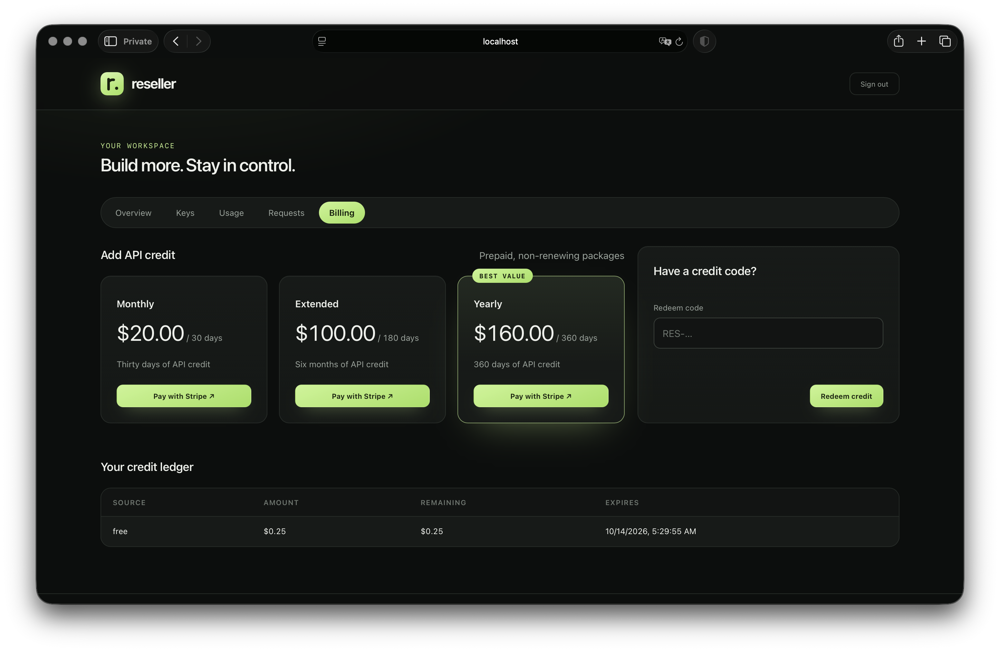

<p align="center">
  
</p>

# reseller

**Your API. Your pricing. One binary.**

A self-hosted, OpenAI-compatible API reseller platform written in Rust. Proxy language, text-to-speech, speech-to-text, and image generation/editing requests; issue customer keys; meter usage; sell prepaid credit by card or crypto; and manage everything from an embedded, white-label web workspace.

- Streaming JSON, SSE, audio, multipart uploads, and WebSocket transport
- Separate LLM / TTS / STT / image upstreams with per-upstream timeouts, headers, model policies, and fallback chains
- Self-service accounts, shared balances, key rotation, model allowlists, and usage limits
- Integer micro-USD accounting, expiring credit lots, markup overrides, and debt tracking
- Prepaid plans, single-use redeem codes, Stripe Checkout, and Payroof crypto payments (USDC/USDT and native coins on EVM chains) with verified, idempotent webhooks
- White-label branding: name, copy, logo, favicon, colours, custom CSS, and an optional theme directory
- Customer and administrator dashboards, request history, usage charts, live statistics API
- SQLite WAL with ordered migrations; no external database or frontend build required
- Non-root Docker image for AMD64 and ARM64

## Screenshots

Customer workspace — choose a plan, redeem a credit code, and follow the credit ledger:



## Install and run

Once the first release has been published to crates.io:

```sh
cargo install reseller --locked
reseller init
# Edit reseller.toml: set [llm].api_key and your upstream URL/model.
reseller
```

From this checkout, before publication:

```sh
cargo install --path . --locked
reseller init
reseller
```

Or bootstrap from environment variables:

```sh
OPENAI_BASE_URL=https://openrouter.ai/api/v1 \
OPENAI_API_KEY=sk-or-v1-... \
OPENAI_MODEL=your-model \
reseller
```

On first startup, an administrator token is generated and printed if none was supplied. **Save it.** Open:

| Page | URL |
|---|---|
| Landing / create key | `http://localhost:56787/` |
| Customer workspace | `http://localhost:56787/workspace/` |
| Administrator console | `http://localhost:56787/admin/` |
| OpenAI-compatible base URL | `http://localhost:56787/v1` |
| Liveness / readiness | `/healthz` / `/readyz` |

`reseller --help` lists all options. The default database is `.reseller/reseller.db` relative to the working directory. Rust 1.98+ is required to build.

```sh
reseller --host 127.0.0.1 --port 8080
reseller --database /srv/reseller/reseller.db serve
reseller doctor
reseller token                         # generate a new random token
reseller backup ./reseller-backup.db   # online SQLite snapshot
reseller reset-admin                   # stop the server first; then restart
reseller healthcheck                   # probe the local /readyz (container health check)
reseller config export > settings.toml # stored settings as TOML (secrets blanked; --include-secrets)
reseller config import settings.toml   # stop the server first; blank secrets keep stored values
reseller --theme-dir ./theme           # serve white-label files under /theme/
```

## Docker / GitHub Container Registry

After a release publishes the image:

```sh
docker run -d --name reseller --restart unless-stopped \
  -p 56787:56787 \
  -e OPENAI_BASE_URL=https://openrouter.ai/api/v1 \
  -e OPENAI_API_KEY=sk-or-v1-... \
  -e OPENAI_MODEL=your-model \
  -e PUBLIC_URL=https://api.example.com \
  -v reseller-data:/data \
  ghcr.io/reseller-rs/reseller:latest

docker logs reseller  # first-start administrator token
```

Or use `docker compose up -d`. Environment substitution is supported through your shell or a Compose `.env` file. Pin a release tag instead of `latest` for controlled upgrades.

Build locally with `docker build -t reseller:local .`. The release binary is a static musl build compiled with size-first release settings (`opt-level = "z"`, fat LTO, one codegen unit, `panic = "abort"`, stripped), and the runtime image is `scratch` plus the binary, the CA bundle, and an empty writable `/data` — no shell, no curl, no package manager. The image runs as UID/GID `10001`, uses `/data/reseller.db`, and its healthcheck invokes `reseller healthcheck`, which probes the local `/readyz` over TCP. Bind-mounted directories must be writable by that UID. Keep the data volume across upgrades. Allow up to the upstream timeout for graceful shutdown.

## Configuration

`reseller init` creates a starter TOML file with private permissions. It documents every setting; optional settings are commented out with their defaults. On **first start only**, TOML and bootstrap environment variables seed SQLite (the file is not even read once the database holds settings). Afterwards **Admin → Settings** is authoritative; to manage settings as a file, use `reseller config export` / `reseller config import` with the server stopped. Environment/file edits do not override an existing database.

Settings are grouped into sections: top-level access, billing and limit options; `[llm]`, `[tts]`, `[stt]`, `[image]` upstreams; `[prices.*]`; `[default_limits]`; `[branding]`; `[stripe]`; and `[payroof]`.

Always-runtime options: `HOST`, `PORT`, `DB_FILE`, `RESELLER_CONFIG`, `RESELLER_THEME_DIR`, `RUST_LOG`, and corresponding CLI flags. The application does not automatically read `.env` files.

`ADMIN_TOKEN` and `KEY_PEPPER` must be at least 24 characters; leave them unset to have secure values generated. Supported bootstrap variables:

```text
OPENAI_BASE_URL / OPENAI_API_KEY / OPENAI_MODEL / OPENAI_MODEL_FALLBACKS
TTS_BASE_URL    / TTS_API_KEY    / TTS_MODEL    / TTS_MODEL_FALLBACKS / TTS_VOICE
STT_BASE_URL    / STT_API_KEY    / STT_MODEL    / STT_MODEL_FALLBACKS
IMG_BASE_URL    / IMG_API_KEY    / IMG_MODEL    / IMG_MODEL_FALLBACKS
ADMIN_TOKEN / KEY_PEPPER / MARKUP_PCT / FREE_CREDIT_USD / PUBLIC_URL / BRAND_NAME
STRIPE_SECRET_KEY / STRIPE_WEBHOOK_SECRET
PAYROOF_API_URL / PAYROOF_PROJECT / PAYROOF_TOKEN / PAYROOF_WEBHOOK_SECRET
```

Fallback lists are comma-separated. Each upstream is configured independently and may set `timeout_seconds` (0 uses `upstream_timeout_seconds`) and extra request `headers` (for example OpenRouter's `HTTP-Referer`/`X-Title`; credentials and framing headers cannot be overridden). Set TTS/STT/image keys if you use those routes. `public_url` controls dashboard links and payment redirects; set it to the externally reachable origin.

Price-table model names match case-insensitively. `ip_overrides` maps an IP address to its monthly key allowance (`0` = unlimited). Settings include `model_policy` and `voice_policy` (`default`, `force`, `passthrough`), body limits, timeout, CORS, key-creation limits, default per-key limits, retention, prices, and payment secrets. CORS changes take effect after restart; other settings apply to new requests. Secrets are redacted in API responses; blank secret fields preserve the current value. Changing the key pepper invalidates all customer credentials and unredeemed codes.

Use decimal **strings** for prices, percentages, and spend-limit amounts:

```json
{
  "markup_pct": "30",
  "prices": {
    "default": { "input": "0.5", "output": "1.5", "audio_second": "0", "image": "0" },
    "my-tts-model": { "input": "0", "output": "0", "audio_second": "0.001", "image": "0" },
    "my-image-model": { "input": "0", "output": "0", "audio_second": "0", "image": "0.04" }
  },
  "default_limits": {
    "rpm": 60,
    "requests": { "max": 2000, "window_hours": 24 },
    "tokens": { "max": 1000000, "window_hours": 720 },
    "spend": { "max_usd": "5", "window_hours": 720 },
    "max_children": 2,
    "allowed_models": []
  }
}
```

Price-table input/output rates are USD per million tokens; audio rates are USD per second; image rates are USD per generated image. Management endpoints also accept numeric USD amounts for grants/plans/codes. Responses expose money as decimal strings and timestamps as Unix seconds. Expiry inputs accept Unix seconds or RFC3339.

## Branding and themes

Everything customer-facing can be rebranded without rebuilding: edit `branding` in **Admin → Settings** (or `[branding]` in the seed file).

| Setting | Effect |
|---|---|
| `name`, `tagline`, `description` | Header, footer, page title (`name — tagline`), meta description |
| `logo_url`, `favicon_url` | Site path (for example `/theme/logo.svg`) or `http(s)` URL; empty uses the built-in mark |
| `theme_color`, `color_scheme` | Browser UI colour and `dark`/`light` scheme |
| `css_vars` | Overrides of the built-in CSS custom properties, without `--`: `accent`, `accent-2`, `accent-ink`, `bg`, `bg-soft`, `panel`, `panel-2`, `border`, `text`, `muted`, `radius`, … |
| `custom_css` | Extra stylesheet (≤ 64 KiB) appended after the built-in theme |
| `hero_eyebrow`, `hero_title`, `hero_text` | Landing page copy |
| `footer_text`, `footer_links` | Footer text and up to ten `{label, url}` links |

```json
{"branding": {"name": "Acme AI", "logo_url": "/theme/logo.svg", "favicon_url": "/theme/favicon.png",
  "css_vars": {"accent": "#ff7a1a", "accent-2": "#ff9f4a", "accent-ink": "#1d0d00"}}}
```

For files, start with `--theme-dir ./theme` (or `RESELLER_THEME_DIR`). Images, icons, and fonts in that directory are served at `/theme/<path>` (dot-files, traversal, symlinks out of the directory, and unknown file types are refused). A `theme.css` file is appended to `/assets/theme.css`, and an `index.html` file replaces the page template; it can use the placeholders `{{title}}`, `{{name}}`, `{{description}}`, `{{theme_color}}`, `{{color_scheme}}`, `{{logo_url}}`, `{{favicon_links}}`, `{{footer_text}}`, `{{footer_links}}`, and `{{branding_json}}` (keep the `<script type="application/json" id="branding">`, `/assets/style.css`, `/assets/theme.css`, and `/assets/app.js` references). All values are escaped. The Content-Security-Policy allows same-origin scripts/styles/fonts and `https:` images.

## Proxying

```sh
curl http://localhost:56787/v1/keys \
  -H 'Content-Type: application/json' \
  -d '{"name":"my-app","contact":"me@example.com"}'

curl http://localhost:56787/v1/chat/completions \
  -H "Authorization: Bearer $RESELLER_KEY" \
  -H 'Content-Type: application/json' \
  -d '{"model":"your-model","messages":[{"role":"user","content":"Hello"}],"stream":true}'
```

Omit `model` to use the configured `[llm].model` under `model_policy = "default"`. `passthrough` forwards the client's value unchanged (a wrong model fails upstream), and `force` always uses the configured model. The same policy governs the multipart `model` field on uploads: `force` replaces it, `default` fills it only when missing, and the audio payload still streams without buffering. Fallbacks only apply when the final model equals the route's configured model (for example `[llm].model` or `[image].model`).

The API key and dashboard token are shown only once and stored as HMAC-SHA256 hashes. Dashboard tokens manage accounts but **cannot call the proxy**. Blocked API keys retain workspace access; revoked credentials do not. All keys on an account share credit.

Routing replaces `/v1` with the configured base path and preserves query strings:

- `/v1/audio/speech` → TTS
- `/v1/audio/transcriptions`, `/v1/audio/translations` → STT
- `/v1/images`, `/v1/images/*` (generations, edits, variations) → image
- All other `/v1/*` proxy routes → LLM

Image generation and editing (JSON with inline reference images, or multipart edits):

```sh
curl http://localhost:56787/v1/images \
  -H "Authorization: Bearer $RESELLER_KEY" \
  -H 'Content-Type: application/json' \
  -d '{"model":"meta/muse-image","prompt":"Make the sky orange",
       "input_references":[{"type":"image_url","image_url":{"url":"data:image/jpeg;base64,…"}}]}'
```

JSON requests apply model/voice policies; chat streams request usage reporting. Multipart uploads stream with bounded size while the `model` form field alone is rewritten by the policy, so with `force` (or `default` plus a configured model) the request is admitted and metered against the configured model rather than an unknown one. WebSocket (realtime) connections apply the same policy to the `?model=` query parameter before admission and forwarding.

Fallbacks apply only to JSON requests using the configured model, and only before forwarding response headers. Availability errors (`400/402/404/408/429/5xx`) and connection/timeouts can trigger the next model. Fallback models must also be allowed by the key. Client-selected models are not replaced by fallbacks, and multipart uploads get a single forward attempt because the payload cannot be replayed. Redirects are not followed. Hop-by-hop headers and local credentials are removed before forwarding.

Responses include `X-Request-Id`, `X-Key-Prefix`, `X-Account-Balance-USD` (pre-request snapshot), and `X-Model-Fallback` when applicable. Failures use `{ "error": { "code": "...", "message": "..." } }`: `401` credentials, `402` balance, `403` policy, `429` limits, `413` body size, `502/504` upstream failure.

### Accounting semantics

1. Provider `usage.cost` takes precedence, including an explicit zero.
2. Otherwise token, audio, and generated-image usage is priced using the model table or `default`.
3. Markup resolves **key → account → global**.
4. Credit is consumed soonest-expiring-first; non-expiring lots come last.
5. Usage, debit, request metadata, and counters commit in one transaction.

Balance and spend/token checks are soft preflight limits: concurrent in-flight requests can overshoot. Uncovered spend becomes account debt, and future top-ups settle that debt before becoming spendable credit. Request admission and RPM checks are serialized in SQLite; hourly usage windows include the entire boundary hour. A completed admitted request counts even if the upstream failed. Model usage is aggregated for up to 367 days; detailed request retention is independently bounded.

SSE inspection works across chunk boundaries with bounded memory. JSON bodies up to 4 MiB are parsed whole; larger ones (for example base64 images) keep only their last 256 KiB, from which the trailing `usage` object is read, while inline images are counted as they stream. WAV and 16-bit PCM durations (rate/channels from the content type, default 24 kHz mono) can be estimated. **If a provider returns no usage and no supported audio duration, cost is zero**; configure providers that report usage for reliable billing. WebSocket sessions are authenticated, admitted, and logged like other requests; usage from each realtime `response.done` event is summed and billed when the session ends. Balance is checked at admission only, so a long session can run into debt. Sessions are bounded by `upstream_timeout_seconds`. Upstream costs for failed fallback attempts cannot be recovered unless the provider reports them in the final response.

## Payments

Plans are non-renewing prepaid credit packages; `duration_days` sets their credit expiry. Customers buy them in **Workspace → Billing** with any enabled method; administrators can also issue single-use credit/plan codes, grant plans, or add credit directly. Every checkout creates a server-side order that snapshots the plan's price, credit, and duration, and a verified provider event (or an administrator) grants exactly that snapshot, once. Browser redirects never grant credit. Automatic recurring subscriptions and refunds/chargebacks are not implemented.

`GET /v1/plans` lists the enabled `payment_methods` (`stripe`, `crypto`); `POST /v1/account/checkout {"plan_code","method"}` starts a checkout (the first enabled method when `method` is omitted).

### Cards (Stripe Checkout)

1. Set `stripe.secret_key`, `stripe.webhook_secret`, and your external `public_url` in Settings (or the bootstrap environment on first start).
2. Register `https://api.example.com/webhooks/stripe` in Stripe for `checkout.session.completed` and `checkout.session.async_payment_succeeded`.
3. Stripe prices must be at least `$0.50`, in whole cents, and denominated in USD.

The webhook verifies the signature over the raw body with a five-minute tolerance. It requires a paid session with matching currency/amount/order/session. Event IDs and paid-order state prevent duplicate grants, including multiple event types for one session. Delayed methods are credited only when confirmed paid. Use Stripe test mode and the Stripe CLI to validate your configuration:

```sh
stripe listen --forward-to localhost:56787/webhooks/stripe
# Save the emitted whsec_ secret in Settings, then make a test checkout in the UI.
```

### Crypto (Payroof)

[Payroof](https://payroof.top) watches EVM chains for payments to deterministic per-order addresses derived from your watch-only key; it can never move funds. Reseller accepts **USD stablecoins** (`stablecoins`, default USDC and USDT, valued 1:1) and **native coins** (ETH, POL, BNB, … valued at the current USD rate) on every chain your Payroof project watches (or the `chains` allowlist).

1. Create a Payroof project (see the Payroof guide) and set `payroof.project` and `payroof.token` (a `prf_…` token with the `references` and `webhooks` permissions) in Settings.
2. Set `public_url` to your public **https** origin, open **Admin → Payments → Crypto payments setup**, and click **Register webhook**. This subscribes `{public_url}/webhooks/payroof` to `seen` and `confirmed` events and stores the signing secret (or paste the `whsec_…` of an existing webhook into `payroof.webhook_secret`).
3. Crypto checkout is offered once project, token, and webhook secret are set.

At checkout Reseller allocates the order's Payroof reference and stores a quote per accepted asset: stablecoins at the plan price in the token's own decimals, native coins at the current rate rounded up to 8 decimals. Rates come from a CoinGecko-compatible `rate_url` (`rate_ids` maps symbols to coin ids, cached for two minutes) or from fixed `native_rates_usd` (which also override the feed; `rate_source = "static"` disables the feed). Quotes hold for `quote_ttl_minutes`. The payment dialog shows each asset, network, amount, and deposit address and updates itself until the order is paid.

Webhooks are verified (HMAC-SHA256 with the decoded `whsec_` key, ±300 s) before parsing and deduplicated by `Payroof-Id`. `seen` records the transfer; `confirmed` values it against its quote (`amount / quoted amount × price`). Payments in several transfers or assets add up, and the order is paid once confirmed value covers the price minus `underpayment_tolerance_pct`. Transfers in unquoted assets, to a different address, or of native coins first seen after the quote expired are recorded with a note and not counted; stablecoins are honoured even after expiry. Review them in **Admin → Payments → Details**, where **Mark as paid** completes an order by hand. Events for other projects or unknown references (other applications sharing the project) are acknowledged and ignored. Sweep received funds from your own wallet.

## API reference

Customer authentication: `Authorization: Bearer <api key or dashboard token>` (or `x-api-key`). Admin authentication: `x-admin-token` or bearer token. Tokens in query strings are deliberately unsupported.

```text
GET    /v1/plans                         public active plans
POST   /v1/keys                          public signup / authenticated additional key
GET    /v1/keys                          own keys
PATCH  /v1/keys/:id                      rename or block
POST   /v1/keys/:id/rotate               replace key, preserving limits/pricing/expiry
GET    /v1/account                       account, credits, subscription
GET    /v1/account/usage?days=30&key=     daily/model usage
GET    /v1/account/requests?limit=20&offset=0&key=
POST   /v1/account/redeem                {"code":"RES-..."}
POST   /v1/account/checkout              {"plan_code":"monthly","method":"stripe"|"crypto"}
GET    /v1/account/payments              own orders (latest 50)
GET    /v1/account/payments/:id          order with crypto quotes and transfers
POST   /webhooks/stripe                  Stripe-signed raw event
POST   /webhooks/payroof                 Payroof-signed transfer event
```

Admin routes under `/admin/api`:

```text
GET    /overview                        lifetime totals, margin, accounts, credit
GET    /usage?days=30                    daily/model series
GET    /events                          SSE snapshot every five seconds
GET    /keys?q=&status=&account=&limit=&offset=
GET    /keys/:id
PATCH  /keys/:id                        name, status, limits, markup_pct, expires_at
POST   /keys/:id/rotate
POST   /keys/:id/revoke
GET    /accounts?q=&status=&limit=&offset=
GET    /accounts/:id
PATCH  /accounts/:id                    status, contact, note, markup_pct, can_create_keys
POST   /accounts/:id/keys               name, limits
POST   /accounts/:id/credits            amount_usd, source, expires_at?, note?
POST   /accounts/:id/subscriptions      plan_code
GET    /plans
POST   /plans                          upsert code, name, price_usd, credit_usd,
                                       duration_days, active?, description?
DELETE /plans/:code                    only while unreferenced; otherwise deactivate
GET    /codes
POST   /codes                          object or array (max 100) of
                                       {credit_usd OR plan_code, expires_at?, note?}
PATCH  /codes/:id                      expires_at, note (unredeemed codes only)
DELETE /codes/:id                      cancel an unredeemed code
GET    /payments                       orders: q, status, sort, dir, limit, offset
GET    /payments/:id                   order with quotes and transfers
POST   /payments/:id/complete          mark a pending/expired order paid (grants once)
GET    /payroof                        Payroof configuration, catalog, webhooks
POST   /payroof/webhook                register {public_url}/webhooks/payroof
GET    /requests                       q, model, kind, status, path, ip, method,
                                       key, account, hour, limit, offset
GET    /requests/groups?field=model     model|ip|status|kind|path|key|hour
GET    /settings                       redacted configuration
PATCH  /settings                       validated partial configuration
```

List limits default to 50 and cap at 200. Detailed account credit history, codes, and payments return the latest 200. The customer UI uses session storage, removes login tokens from URL fragments, and never embeds credentials in page HTML. Logs contain request metadata, not prompts, bodies, audio, auth headers, or query strings.

## Operations

Place a TLS reverse proxy in front of public deployments. `trust_proxy` defaults off; enable it only when direct access to the application is blocked and your edge overwrites incoming forwarding headers. It trusts `CF-Connecting-IP`, then the **last** `X-Forwarded-For` address (the one your proxy appended; earlier entries are client-controlled). Self-service defaults to two keys per IP/calendar month, a 30-second cooldown, and 100 creations globally/hour. Subscribed/permitted accounts bypass the IP allowance, but not the global or account key caps. Use edge rate limits for management endpoints and payment attempts.

Database settings contain upstream/payment secrets: protect the database and backups as credentials. API keys and codes are hashed; upstream secrets must be recoverable to proxy requests. Do not share the same database between multiple running server instances. Take a backup before upgrades. Migrations apply automatically; restore a backup with the server stopped. **0.3.0 is not backward compatible**: the schema and the settings layout changed (`site_name` → `branding.name`, `stripe_*` → `[stripe]`, new `[image]`/`[payroof]` sections) and 0.2.x databases are not migrated. Start 0.3.0 with a new database file and an updated seed TOML (`reseller init` writes a fresh template). An abrupt process or machine failure can lose usage that an upstream has not yet reported; interrupted requests remain identifiable in the database.

## Development

```sh
cargo fmt --all --check
cargo clippy --locked --all-targets -- -D warnings
cargo test --locked
```

Source layout (`src/`):

| Module | Responsibility |
|---|---|
| `main.rs` | CLI: `serve`, `init`, `doctor`, `token`, `reset-admin`, `backup`, `healthcheck`, `config export/import` |
| `web.rs` | Router, security headers, CORS, static assets, top-level dispatch |
| `theme.rs` | Branded page template, generated theme CSS, theme-directory files |
| `proxy/` | Upstream transport: JSON policies and fallbacks, streamed uploads (`multipart.rs`), usage inspection (`inspect.rs`), realtime relay (`websocket.rs`) |
| `meter.rs` | Admission (status, balance, RPM/usage limits) and exactly-once settlement |
| `api/` | Customer workspace (`customer.rs`) and administrator console (`admin.rs`) JSON APIs |
| `identity.rs`, `keys.rs` | Credential hashing/authentication; key limits, creation guards, rotation |
| `billing.rs`, `money.rs` | Credit ledger, plans, redeem codes, micro-USD arithmetic |
| `payments/` | Checkout orders (`mod.rs`), Stripe Checkout (`stripe.rs`), Payroof crypto quotes, rates and webhooks (`payroof.rs`) |
| `stats.rs` | Overview, usage series, log retention |
| `config/` | Settings (`mod.rs`), branding (`branding.rs`), payment providers (`payments.rs`) |
| `db.rs`, `error.rs` | SQLite access, API error type |

The embedded UI (`assets/`) is plain HTML/CSS/JS served under a strict Content-Security-Policy; there is no frontend build step. Integration tests in `tests/` drive the real router against mock upstreams.

## License

MIT.
